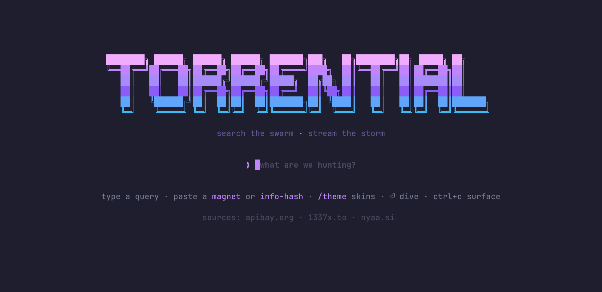

<div align="center">



**hunt the episode · stream the storm**

A torrential downpour of TV, right in your terminal.

torlink-inspired TUI · programmatic WebTorrent engine · series → seasons → episodes, zero wait

[](https://github.com/frierens-arm/torrential/actions/workflows/ci.yml)

[Features](#features) · [Install](#install) · [Quickstart](#quickstart) · [Keys](#keybindings) · [Configuration](#configuration) · [Changelog](CHANGELOG.md)

</div>

---

**torrential** pairs [torlink](https://github.com/baairon/torlink)'s search
workflow with [webtorrent-cli](https://github.com/webtorrent/webtorrent-cli)'s
streaming engine: type what you want, pick the healthiest result, and start
watching while the pieces are still falling — no full download, no web UI, 100%
terminal.

Episodic results group into **series → seasons → episodes**, with season packs
pinned and a file picker for multi-file torrents. Movies land in a **flat list**,
best swarm first. `auto` (default) routes each search by classifier vote,
`--mode tv|movies` pins it, and `/mode` switches live.

Want it on the sofa instead of the desk? Press `l` and scan the QR: the file
streams to your phone, the desktop player closes, and the computer keeps
seeding. No phone app, no copy, no download.

```
  ❯ Breaking Bad  ›  Season 1

     #  EPISODE  BEST TORRENT                          SEED      SIZE  QUALITY
   ▸ E01       Breaking Bad S01E01 2008 720p…          120   1.2 GB  720p
     E02       Breaking Bad S01E02 720p BluRa…          110   1.1 GB  720p
     ── season packs ─────────────────────────────────
     PACK      Season 1 · Complete 720p                 210   9.9 GB  720p
```

```
  ▶ streaming via mpv

  Breaking.Bad.S01E01.720p.mkv — 1.2 GB (file 1 of 5 in this pack)
  endpoint http://127.0.0.1:8000/webtorrent/08ada5a7…/Breaking.Bad.S01E01.720p.mkv

  [████████████▓░░░░░░░░░░░░░░░░░░░░░░░░] 42.3% cached

  ↓ 3.8 MB/s · ↑ 120 kB/s · peers 18 · eta 41s · swarm 38%
```

## Features

- **Series tiers, not a search dump** — shows group into seasons and episodes;
  season packs are pinned below the grid, and multi-file torrents open a picker
  that pre-highlights the episode you asked for.
- **Smart hunts** — a thin season or episode view automatically re-queries every
  source with `SxxExx` and `1xx` forms (`breaking bad S02E05`, `breaking bad 205`)
  and merges the answers in place.
- **Instant streaming** — the magnet goes straight into an in-process
  [WebTorrent](https://webtorrent.io) engine. The first ~4 MB and the file tail
  (MP4 `moov` / MKV `Cues`) start downloading before the player opens, and a
  playhead-tracking turbo server keeps a rolling priority window ahead of
  playback.
- **Any player** — system default handler out of the box, with an automatic
  mpv → VLC → IINA fallback chain. `torrential -df iina` validates and saves your
  choice; `--list-players` shows what's installed.
- **Watch on your phone** — press `l` (or start with `--phone`) for a scannable
  QR in the terminal. The phone opens a lean web player on the same Wi-Fi and
  playback moves there: the desktop player closes, the engine keeps seeding,
  and nothing is stored on the phone. Containers a browser cannot decode get a
  one-tap VLC hand-off. LAN-only, behind a per-session token.
- **Clean disk by default** — closing the player wipes the temporary piece
  cache. `-k`/`--keep` rescues the watched file into your videos folder instead.
- **Works when the network doesn't** — sources run concurrently, a blocked one
  only dims to a footnote, and 1337x DNS blocks retry over DNS-over-HTTPS.
  `--doctor` reports what is broken; `--debug` writes a diagnostic log.
- **Continuity** — recent searches are recalled with `↑`/`↓`, the last episode
  streamed from a season is preselected and marked `▶`, and a finished episode
  offers the next one (`⏎`).
- **Eight skins** — `rain`, `matrix`, `sunset`, `ocean`, `ember`, `candy`,
  `amber`, `mono`. `--theme matrix` for one session, `/theme` for a live picker.

## Requirements

| | |
|---|---|
| Node.js | **≥ 22.0** — `webtorrent@3` will not run on 18/20 |
| OS | Linux, macOS, Windows |
| Player | system default handler, mpv, VLC, or IINA (macOS) |
| Phone | any modern mobile browser on the same Wi-Fi — iOS Safari 15+, Chrome or Samsung Internet |

> `mpv` gives the best experience — it starts HTTP streams almost immediately
> and honours `Range` seeking. `brew install mpv` · `apt install mpv` ·
> `winget install mpv`

## Install

```bash
cd torrential
npm install          # native bits compiled for your OS
npm run build        # compiles dist/ (prebuilt dist/ ships in the tarball too)
npm link             # puts `torrential` on your PATH
```

No global install needed: `node dist/cli.js` runs the checkout directly. No
external tools either — every speed feature is pure Node/WebTorrent.

- **`EBADENGINE` / `ReferenceError: File is not defined`** — you're on Node
  18/20. Install Node 22 first; `.npmrc` makes the failure happen at install
  time with a clear message.
- **`EACCES` on `npm link` or `npm install -g`** — don't use `sudo`; see
  [Troubleshooting](docs/TROUBLESHOOTING.md#npm-err-code-eacces--permission-denied).

## Quickstart

```bash
torrential                        # the search bar
torrential "breaking bad"         # episodic hunt
torrential "oppenheimer"          # auto-routes movie-heavy results to a flat list
torrential --mode movies "sintel"  # force the flat list
torrential --magnet "magnet:?xt=urn:btih:…"   # or a bare 40-char info-hash
torrential --player mpv --port 9000 "severance"
torrential -k "the last of us"    # keep the file (~/Movies/torrential)
torrential --keep=~/watchlist "frieren"
torrential --sources tpb,nyaa "severance"     # skip a blocked source
torrential --phone "severance"    # scannable QR; playback moves to your phone
torrential --phone --lan-ip 192.168.1.42 "severance"   # pin the QR address
torrential --doctor               # check Node, player, port, sources
torrential --debug "severance"    # write <cache>/torrential.log
torrential --no-player --magnet '…'           # print the stream URL only
torrential --clear-cache          # wipe the cache, then run
```

The search bar also takes pasted magnets, bare info-hashes, and slash commands:
`/theme [name]`, `/mode [auto|tv|movies]`, `/skin` (alias for `/theme`).

## Watch on your phone

Press `l` on the stream screen — or start with `--phone` — and torrential puts a
QR code in the terminal. Scan it with the phone camera: the page opens a web
player on that phone and streams the file over your Wi-Fi. The desktop player is
closed first, so playback really moves; the computer keeps downloading and
seeding while the phone plays.

```
  ⌁ watch on your phone
  ┌───────────────────────────────┐
  │  ░░▒▒▓▓██▓▓▒▒░░  ██▓▓▒▒░░░   │
  │  ██▒▒░░▓▓██▒▒░░  ▒▒██▓▓░░░   │
  │  ▒▒░░██▓▓▒▒██░░  ▓▓▒▒██░░░   │
  │      (illustration only)      │
  └───────────────────────────────┘
  ○ waiting for your phone to load the page…
  http://192.168.1.42:8000/p/abcd2345
  same Wi-Fi · opens as a web player, nothing is saved on the phone
```

- **Streamed, never saved.** The page holds a normal HTTP stream with `Range`
  seeking. There is no download link and no `Content-Disposition`; closing the
  tab ends it. The seconds the phone buffers are ordinary playhead readahead.
- **LAN only, token scoped.** While sharing is off, requests from anywhere but
  this machine get a 404 on every route. While it is on, a phone can reach only
  `/p/<random-token>` and its media route — the canonical endpoint never becomes
  network-reachable. `l` again revokes the token instantly.
- **Containers.** MP4 and WebM play inline. MKV, HEVC and AC3 usually do not, so
  the page offers **Open in VLC** (Android `intent://`, iOS
  `vlc-x-callback://`) plus a copy-link button for Infuse, nPlayer or anything
  else you have installed.
- **Address.** The QR advertises the detected Wi-Fi/Ethernet IPv4, preferring
  192.168 → 172.16 → 10 and pushing virtual adapters (docker, VPN tunnels) last.
  Multi-NIC or VPN machines can pin it with `--lan-ip 192.168.1.42`.
- **Terminal width.** The QR needs roughly 40 columns; narrower terminals print
  the URL instead. The playhead follows whichever device is reading, so turbo
  buffering keeps working for the phone with no extra setup.
- **It tells you when the phone arrives.** The screen shows
  `○ waiting for your phone…` until the first media request, then
  `● phone connected — playback moved to your phone`. If it never flips, the
  phone never reached the computer: check the macOS Local Network permission,
  the firewall, and router client/AP isolation (see Troubleshooting).

## Keybindings

| Key | Action |
|---|---|
| `j` / `k`, `↑` / `↓` | move the selection |
| `⏎` | open the row: series → seasons → episodes → pre-flight → stream (also applies a skin in the picker) |
| `n` / `p` | cycle next / previous torrent on the pre-flight card |
| `g` / `G` | jump to top / bottom |
| `PgUp` / `PgDn` | page through long lists |
| `l` | share the stream to your phone (QR) / stop sharing |
| `b` | back one tier; from the stream: stop |
| `esc` / `q` | back / new search / stop (wipes the cache unless `--keep`) |
| `Ctrl+C` | quit anywhere |
| `↑` / `↓` in the search bar | recall recent searches |

A finished episode drops you back on the **episode grid**, cursor already on the
next episode — not on the torrent card for the one you just watched. Stopping
a stream early still returns to that pre-flight card, where swapping torrents
for the same episode belongs.

## Configuration

JSON config lives at `~/.config/torrential/config.json`
(`%APPDATA%\torrential\config.json` on Windows), created with defaults on first
run. CLI flags always win.

```json
{
  "default_player": "mpv",
  "cache_directory": "~/.cache/torrential",
  "keep_directory": "~/Movies/torrential",
  "port": 8000,
  "providers": ["piratebay", "1337x", "nyaa"],
  "mode": "auto",
  "turbo": true,
  "max_conns": 200,
  "ram_cache_mb": 256,
  "upload_limit_kbps": 0,
  "theme": "rain"
}
```

Phone sharing is session state, not configuration: `--phone` and `--lan-ip` are
per-run flags and add no config keys. Every persisted option (timeouts,
piece-window tuning, 1337x mirrors, per-player flags) is documented in
**[docs/CONFIG.md](docs/CONFIG.md)**. Two siblings are
machine-managed and safe to delete: `state.json` (search history + last-watched
episodes) and `<cache>/torrential.log` (only written with `--debug`).

## How streaming works

The selected magnet is added to a pre-warmed WebTorrent client; metadata is
cached so re-streams start instantly. The first ~4 MB and the file tail are
marked critical before your player connects, then a local HTTP server exposes
the file with full `Range` support. In turbo mode that server watches the
playhead and keeps ~30 s of video prioritized ahead of it, escalating when the
swarm falls behind. A phone reading the tokenized share URL is treated like any
other player: its Range requests move the playhead, so the window follows the
phone the moment the desktop player closes. In practice: you watch while the
rest falls in, and the cache is wiped when you stop. Details in
[docs/ARCHITECTURE.md](docs/ARCHITECTURE.md).

## Troubleshooting

Run `torrential --doctor` first; reproduce with `--debug` if it still fails.
Common cases:

| Symptom | Fix |
|---|---|
| `no metadata after 45s — swarm looks dead` | Pick a result with more seeders. |
| Playback stalls at 0% | Press `q`, retry, or pick a better-seeded release. |
| `1337x blocked` (HTTP 403) | Cloudflare on VPN IPs — retry, drop it with `--sources tpb,nyaa`, or set `x1337_mirrors`. |
| `could not start the local stream server` | Port in use — set `port` (torrential also probes nearby ports). |
| `no player found` | Install mpv/VLC or set `default_player` / `--player`. |
| A movie search opened the series view | Re-run with `--mode movies`. |
| Phone cannot load the QR URL | Run `--doctor` first. On macOS, allow your terminal in Privacy and Security → Local Network — without it the OS drops incoming LAN connections silently. Also disable router client/AP isolation and avoid guest SSIDs. |
| `phone share: no LAN IPv4 address found` | No routable LAN address was detected (VPN-only or unusual adapter). Pass `--lan-ip <your-computer-ip>`; the stream URL is printed under the QR as a fallback. |
| Phone page says the browser cannot decode the file | MKV/HEVC/AC3 are beyond mobile browsers. Tap **Open in VLC** (install it first) or copy the link into Infuse/nPlayer. |
| Firewall prompt on the first share | Allow incoming connections for Node/your terminal on **private** networks — macOS and Windows ask once. |

Full matrix, install failures and log locations:
**[docs/TROUBLESHOOTING.md](docs/TROUBLESHOOTING.md)**.

## Development

```bash
npm run dev          # run from TypeScript source (tsx)
npm run typecheck    # strict tsc
npm test             # node:test suite (parser, classifier, server, LAN share, QR, playback)
npm run build        # emit dist/
npm run smoke        # turbo server HTTP compatibility matrix
npx tsx tools/render-smoke.tsx   # Ink renders, including the phone QR block
npx tsx tools/app-smoke.tsx      # mounts the real App headlessly
```

Layout, data flows, test strategy and the dependency/security notes
(`overrides.ip`, `allowScripts`) are in
[docs/ARCHITECTURE.md](docs/ARCHITECTURE.md). CI runs the whole set on
Linux/macOS/Windows × Node 22/24.

## Privacy & legal

Everything runs on your machine: searches go from your terminal to the
indexers, streaming is peer-to-peer, and nothing is routed through a central
server. Phone sharing binds the HTTP server to your LAN only while a tokenized
share is live, and the page is the only route another device can reach. Only
download and share content you have the legal right to.

## Credits

- [torlink](https://github.com/baairon/torlink) — the interactive search workflow
- [webtorrent-cli](https://github.com/webtorrent/webtorrent-cli) — the streaming engine
- [WebTorrent](https://webtorrent.io) — the protocol doing the heavy lifting
- Theme palettes styled after hermes-agent's terminal colors

MIT — see [LICENSE](LICENSE).
